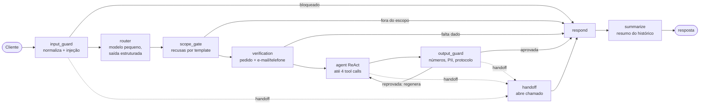
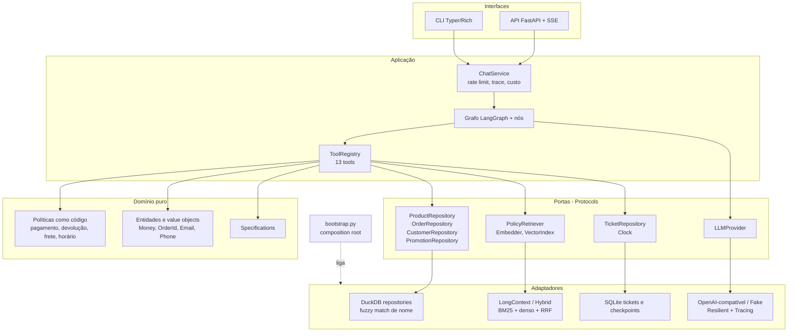
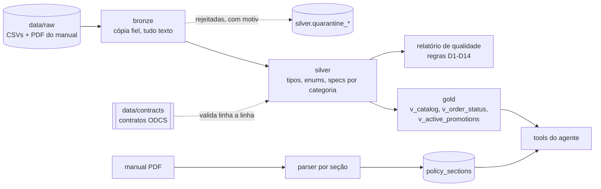

# Tom, o agente de atendimento da Empório da Música

Agente conversacional (LangGraph) que atende clientes de uma loja fictícia de instrumentos musicais em Campo Grande/MS: catálogo, preço e promoção, parcelamento e PIX, status de pedido, trocas e devoluções, frete, horário e contato. Os números (preço, parcela, prazo, protocolo) saem de código determinístico e de dados verificados; o modelo de linguagem conversa, escolhe ferramentas e redige. Resultado da avaliação: veja a seção [Avaliação](#avaliação).

- Funciona offline (provider `fake`) e com qualquer endpoint OpenAI-compatível (Groq, Ollama, OpenAI).
- Dados em camadas medalhão (bronze, silver, gold) sobre DuckDB, com data contracts e quarentena.
- Regras do manual (pagamento, devolução, frete, horário) implementadas como funções puras e testadas.
- Guardas de entrada e de saída, anti-BOLA, PII mascarada, rastreabilidade por spans OpenTelemetry.

## Sumário

1. [Demonstração rápida](#demonstração-rápida)
2. [Quickstart](#quickstart)
3. [Configuração do LLM](#configuração-do-llm)
4. [Arquitetura](#arquitetura)
5. [Decisões técnicas (ADRs)](#decisões-técnicas-adrs)
6. [Suposições e divergências entre dados e manual](#suposições-e-divergências-entre-dados-e-manual)
7. [Avaliação](#avaliação)
8. [Segurança e LGPD](#segurança-e-lgpd)
9. [Observabilidade e custo](#observabilidade-e-custo)
10. [Exemplos de conversa](#exemplos-de-conversa)
11. [Limitações conhecidas e próximos passos](#limitações-conhecidas-e-próximos-passos)
12. [Da PoC à escala](#da-poc-à-escala)
13. [Uso de assistentes de código](#uso-de-assistentes-de-código)

## Demonstração rápida

Sem chave de API e sem rede, usando o provider determinístico:

```bash
make setup
make ingest
EMPORIO_LLM_PROVIDER=fake make chat ARGS="--debug"
```

```text
você> Quais violões vocês têm até R$ 1.000?
você> e de aço?
você> quanto fica o Yamaha F310 no PIX?
```

Com `--debug` (ou `/debug` durante a conversa) o painel técnico mostra, por turno, as intents roteadas, as tools chamadas, as seções do manual citadas, tokens e custo estimado. Conversas completas, geradas por execução real, estão em [Exemplos de conversa](#exemplos-de-conversa).

## Quickstart

Pré-requisitos: [uv](https://docs.astral.sh/uv/) e Python 3.12 (o uv resolve a versão pelo `.python-version`).

```bash
make setup && cp .env.example .env   # instala dependências travadas (uv sync --frozen)
make ingest                          # bronze -> silver -> gold + relatório de qualidade
make chat                            # CLI interativa (Typer + Rich)
make api                             # ou: API FastAPI em http://127.0.0.1:8000
```

| Alvo | O que faz |
| --- | --- |
| `make setup` | `uv sync --frozen`: ambiente reprodutível a partir do `uv.lock`. |
| `make ingest` | Roda `python -m emporio.ingestion`: lê `data/raw/`, valida contra `data/contracts/`, grava `data/emporio.duckdb` e `data/quality_report.json`. Idempotente. |
| `make chat` | CLI de conversa. Comandos: `/debug`, `/reset`, `/sair`. Aceita `ARGS="--debug"`. |
| `make api` | Sobe `uvicorn` com a fábrica `emporio.interfaces.api:create_app` em `127.0.0.1:8000`. |
| `make test` | `pytest` com cobertura: 542 testes passam, 1 é pulado (frescor do relatório live) e 2 `live` ficam desligados; cobertura de 95,3% (piso de 80%). |
| `make lint` / `make typecheck` | `ruff check` + `ruff format --check` / `mypy --strict src`. |
| `make check` | `lint` + `typecheck` + `test`; é o que o CI executa. |
| `make eval-retrieval` | Recall@3 e MRR das estratégias de recuperação (ablation). |
| `make eval` | Avaliação do agente offline (LLM fake, todos os casos); falha abaixo do piso de qualidade. |
| `make eval-replay` | Reproduz offline o cassete gravado pelo `eval-live`. |
| `make eval-live` | Avaliação com provedor real (`EMPORIO_LLM_*`); grava cassete e relatório em `evals/reports/`. Em plano gratuito use `EMPORIO_EVAL_SLEEP=62 make eval-live`. |
| `make examples` | Gera as transcrições de `examples/` com provedor real (`EMPORIO_EVAL_SLEEP=62` no plano gratuito). |

### API

```bash
curl -N http://127.0.0.1:8000/v1/chat \
  -H 'content-type: application/json' \
  -d '{"session_id": "demo-1", "message": "Quanto custa o Takamine GD20?"}'
```

`POST /v1/chat` responde em Server-Sent Events: eventos `step` (nó do grafo), `token` (trechos da resposta) e um evento final com o resumo do turno. `session_id` (`[\w-]{1,64}`) identifica a memória da conversa; sem ele, um novo é gerado. Erros usam um envelope único `{"error": {"code", "message", "request_id"}}` com `X-Request-ID`; excesso de mensagens devolve `429` com `Retry-After`. Também existem `GET /healthz` (liveness) e `GET /readyz` (verifica o DuckDB).

### Docker

```bash
docker build -t emporio-agent .
docker run --rm -p 8000:8000 --env-file .env -v emporio-data:/app/data emporio-agent
```

Imagem multi-stage (uv no build, `python:3.12-slim` no runtime), usuário não-root, banco gerado no build com `make ingest` e `HEALTHCHECK` em `/healthz`. O volume em `/app/data` guarda a memória das sessões e os chamados (SQLite).

## Configuração do LLM

Nada de modelo fixo no código: tudo vem de variáveis `EMPORIO_*` (arquivo `.env`, modelo em `.env.example`).

| Variável | Papel | Padrão |
| --- | --- | --- |
| `EMPORIO_LLM_PROVIDER` | `openai_compatible` ou `fake` (determinístico, sem rede nem chave) | `openai_compatible` |
| `EMPORIO_LLM_BASE_URL` | Endpoint OpenAI-compatível | `https://api.groq.com/openai/v1` |
| `EMPORIO_LLM_API_KEY` | Chave do provedor (`SecretStr`, nunca logada) | vazio |
| `EMPORIO_LLM_MODEL_SMALL` | Roteador, guardas e resumo do histórico | `openai/gpt-oss-20b` |
| `EMPORIO_LLM_MODEL_MEDIUM` | Nó de resposta (ReAct) | `openai/gpt-oss-120b` |
| `EMPORIO_LLM_MODEL_FALLBACK` | Modelo reserva se o principal falhar (opcional) | vazio |
| `EMPORIO_POLICY_RETRIEVER` | `long_context` ou `hybrid` | `long_context` |
| `EMPORIO_USE_SYSTEM_CLOCK` | `true` usa a data real; `false` usa a data de referência | `false` |
| `EMPORIO_REFERENCE_DATETIME` | "Agora" simulado (dados vão de out/2025 a mar/2026) | `2026-03-25T10:00:00-04:00` |
| `EMPORIO_METRO_CITIES` | Cidades da região metropolitana (JSON) | `["Campo Grande"]` |
| `EMPORIO_RATE_LIMIT_PER_MINUTE` | Mensagens por sessão por minuto | `20` |
| `EMPORIO_OTEL_EXPORTER` | `none`, `console`, `jsonl` ou `otlp` | `none` |

Exemplos:

```bash
# Groq (padrão): basta a chave
EMPORIO_LLM_API_KEY=gsk_...  make chat

# Ollama local, sem chave
EMPORIO_LLM_BASE_URL=http://localhost:11434/v1 \
EMPORIO_LLM_MODEL_SMALL=qwen2.5:7b-instruct EMPORIO_LLM_MODEL_MEDIUM=qwen2.5:7b-instruct make chat

# Offline e determinístico (testes, CI, demonstração)
EMPORIO_LLM_PROVIDER=fake make chat
```

O preço por modelo para estimar custo vem de `EMPORIO_LLM_PRICE_TABLE` (JSON) ou dos preços por tier em `settings.py`.

## Arquitetura

### Fluxo de um turno



1. `input_guard` normaliza o texto (NFKC, remove caracteres invisíveis e de controle, limita a 2000 caracteres) e barra injeção de prompt óbvia.
2. `router` classifica em até 15 intents com saída estruturada (modelo pequeno); abaixo de confiança 0,6 pede esclarecimento.
3. `scope_gate` responde por template, sem chamar o modelo grande, o que está fora do escopo: acessórios, assuntos gerais e categorias vazias do cadastro.
4. `verification` exige pedido + e-mail ou telefone antes de tocar em dados de pedido (intents `order_status` e `return_exchange`), com no máximo 3 tentativas.
5. `agent` é o laço ReAct com até 4 tool calls por turno; só as tools da intent roteada chegam ao modelo (menos tokens, menos escolhas erradas).
6. `output_guard` confere cada número, citação e PII da resposta contra o que as tools devolveram; reprovada, a resposta é regenerada uma vez; se a segunda também falhar, entra a resposta segura com handoff.
7. `respond` entrega; `summarize` compacta o histórico fora da janela das últimas 12 mensagens.

As 13 tools: `search_products`, `get_product`, `compare_products`, `find_alternatives`, `list_active_promotions`, `simulate_payment`, `estimate_shipping`, `get_store_info`, `search_policies`, `verify_customer`, `get_order_status`, `check_return_eligibility`, `open_ticket`. Todas devolvem um `ToolResult` tipado (sucesso ou erro semântico), e `open_ticket` é a única escrita.

### Arquitetura hexagonal



O domínio (`src/emporio/domain`, `src/emporio/policies`) não importa framework nem banco. As portas ficam em `src/emporio/ports.py`; os adaptadores em `src/emporio/adapters/` (persistência e retrieval) e `src/emporio/agent/llm/`. `src/emporio/bootstrap.py` é o composition root: o único lugar que escolhe implementações a partir de `Settings`. Trocar provedor de LLM, retriever, relógio ou repositório não toca regra de negócio, e é assim que os testes injetam relógio fixo, LLM fake e repositório em memória.

### Pipeline de dados (medalhão)



- **Bronze**: cópia fiel do CSV, sem interpretar nada; a origem em `data/raw/` é imutável.
- **Silver**: tipagem, enums (`product_status`, `order_status`, `payment_method`), specs normalizadas por categoria. Linha que viola o contrato vai para `silver.quarantine_<tabela>` com hash, JSON original e motivo; as demais entram. A ingestão informa `bronze`, `silver` e `quarentena` por tabela.
- **Contratos**: um YAML por tabela em `data/contracts/`, subconjunto do ODCS v3 (domínio, data product, dono, schema com tipo/obrigatório/único/enum/mínimo/referência, SLA de frescor e consumidores).
- **Gold**: três views consumidas pelo agente. O preço efetivo já vem calculado em `v_catalog`; o agente nunca escreve SQL livre, só consultas parametrizadas pelos repositórios.
- **Relatório de qualidade**: regras D1 a D14 (ver [abaixo](#suposições-e-divergências-entre-dados-e-manual)), gravado em `data/quality_report.json`. O snapshot de referência fica em `tests/snapshots/quality_report.json` e é conferido por teste.
- **Manual**: o PDF é parseado em seções com número e breadcrumb (28 seções), carregadas em `policy_sections` com hash do corpus.

### Políticas como código

O que tem cálculo ou consequência para o cliente não fica no prompt. Funções puras sobre `Money` (decimal, nunca float) em `src/emporio/policies/`:

- `payment.py`: PIX com 5% sobre preço de tabela (não acumula com promoção), parcelas sem juros por faixa, pagamento combinado.
- `returns.py`: arrependimento (7 dias), defeito (30 dias), preferência (7 dias), garantia legal (90 dias), com data-limite calculada.
- `shipping.py`: frete grátis acima de R$ 500,00, taxa fixa de R$ 35,00 na região metropolitana, modalidades e prazos para outras cidades.
- `store.py`: horário de funcionamento, aberto/fechado em um instante, contatos.

Testes de propriedade (Hypothesis) cobrem pagamento; as demais têm testes por seção do manual.

### Retrieval do manual

Duas estratégias atrás da porta `PolicyRetriever`, escolhidas por `EMPORIO_POLICY_RETRIEVER`:

- `long_context` (padrão): entrega ao modelo todas as seções com corpo, na ordem do manual. O manual inteiro tem 28 seções e cabe no contexto; sem índice, sem falso negativo de recuperação.
- `hybrid`: BM25 sobre texto normalizado (sem acento, sem stopwords) + embeddings densos (`paraphrase-multilingual-MiniLM-L12-v2` via fastembed, índice em memória) fundidos por Reciprocal Rank Fusion (k = 60). Existe para a ablation e para o dia em que o manual não couber no contexto.

O chunking é por seção, com metadados (número, título, breadcrumb), de modo que a citação aponta para a cláusula exata.

## Decisões técnicas (ADRs)

**ADR-1: LangGraph com grafo explícito e roteador, não multiagente.**
Contexto: o domínio tem fluxos com ordem obrigatória (identificar antes de consultar pedido; barrar antes de gerar). Decisão: grafo de estados com nós determinísticos nas bordas e um único laço ReAct limitado a 4 tool calls. Consequência: latência e custo previsíveis, depuração por nó (cada nó é um span), e intents novas entram como tools novas. Custo: mais código de orquestração do que um agente genérico de "function calling" solto.

**ADR-2: Regra de negócio em código, não em prompt.**
Contexto: aritmética de LLM erra, e erro de preço ou prazo vira propaganda enganosa. Decisão: parcelas, PIX, frete, prazo de devolução e protocolo são calculados por funções puras; o modelo só repete o que a tool devolveu, e a guarda de saída verifica isso. Consequência: regras testáveis por propriedade e auditáveis. Custo: cada regra nova do manual vira código e teste.

**ADR-3: DuckDB com medalhão e contratos ODCS.**
Contexto: dados pequenos, analíticos, com inconsistências deliberadas. Decisão: DuckDB embarcado, bronze/silver/gold, contrato por tabela e quarentena com motivo. Consequência: zero infraestrutura, ingestão reprodutível (`make ingest`), e a qualidade vira artefato versionado em vez de limpeza silenciosa. Reversão: as portas de repositório permitem trocar por Postgres sem tocar domínio.

**ADR-4: Retrieval do manual por contexto longo, com híbrido como alternativa medida.**
Contexto: 28 seções de manual. Decisão: padrão `long_context`; `hybrid` (BM25 + denso + RRF) mantido e avaliado. A ablation (tabela em [Avaliação](#avaliação)) mostra que o denso não traz ganho sobre BM25 neste corpus, então a complexidade extra não se paga. Consequência: sem dependência de modelo de embedding no caminho padrão. Reversão: `EMPORIO_POLICY_RETRIEVER=hybrid`.

**ADR-5: Provedor OpenAI-compatível e dois tiers de modelo.**
Contexto: o enunciado deixa livre; custo e portabilidade importam. Decisão: um adaptador para qualquer endpoint OpenAI-compatível (Groq como padrão por oferecer plano gratuito), com modelo pequeno no roteador, guardas e resumo, e modelo médio só na resposta, mais provider `fake` para offline. Consequência: troca de provedor é configuração; o roteador em modelo pequeno reduz as chamadas ao modelo caro. Custo: dependência de saída estruturada e function calling do provedor escolhido.

**ADR-6: Memória por sessão com checkpointer SQLite e resumo.**
Contexto: multi-turno precisa de contexto sem crescer sem limite. Decisão: checkpointer do LangGraph em SQLite por `thread_id`, janela das últimas 12 mensagens + resumo do restante. O texto cru não é persistido no checkpoint (a identidade é extraída a cada turno e o estado guarda a versão redigida). Consequência: conversa sobrevive a reinício, sem PII crua em disco.

**ADR-7: Chamados somente anexação, idempotentes.**
Decisão: `open_ticket` é a única escrita; repetir sessão + tipo + resumo devolve o mesmo protocolo (`EMP-AAAAMMDD-NNNN`), e há no máximo um chamado por turno. Consequência: retry e regeneração não duplicam chamado. SLA informado: 24 horas úteis.

**ADR-8: Interfaces finas sobre um único `ChatService`.**
Decisão: CLI (Typer/Rich) e API (FastAPI com SSE) só adaptam entrada e saída; rate limit, tracing e custo vivem no serviço. Consequência: o comportamento é idêntico nos dois canais e testável sem HTTP.

## Suposições e divergências entre dados e manual

Quando dado e manual divergem, a regra foi: **status e flags do dado vencem texto livre; specs vencem descrição; o detalhe da cláusula vence a tabela-resumo; lacuna do manual vira suposição explícita**, nunca invenção.

### Relatório de qualidade (D1 a D14)

Gerado por `make ingest`; as contagens abaixo são as do snapshot em `tests/snapshots/quality_report.json`. IDs de produto vão de 81 a 145.

| Regra | O que detecta | Casos | Tratamento |
| --- | --- | --- | --- |
| D1 | Categorias sem produto | 3 (IDs 6, 7, 8) | Responde que não há no catálogo e lista o que existe. |
| D2 | Nome e descrição citam marcas diferentes | 7 produtos | Usa nome + specs, omite a descrição. O produto 140 cai em D2 e D3. |
| D3 | Specs contradizem a descrição | 4 produtos (137, 139, 140, 142) | As specs prevalecem. |
| D4 | Esquema e formatação de specs variam por categoria | 10 produtos | Normalização na silver. |
| D5 | Ativo sem estoque | 1 (produto 96) | "Temporariamente indisponível", sugere similares. |
| D6 | Descontinuado sem estoque | 1 (113) | Fora do catálogo, sugere sucessor. |
| D7 | Descontinuado com saldo | 1 (136) | O status prevalece: não oferta, sinaliza à loja. |
| D8 | Produto em lançamento aparece em pedido | 2 pedidos (3, 14) | Inconsistência registrada. |
| D9 | Total do pedido difere da soma dos itens | 2 pedidos (3, 20) | Informa `total_brl` do pedido; nunca recalcula. |
| D10 | E-mail compartilhado | 2 clientes (11, 43) | Identidade exige pedido pertencente ao cliente. |
| D11 | Promoções: ver abaixo | ver abaixo | A flag `is_active` é a única vigência. |
| D12 | Despachado com entrega estimada vencida | 1 (pedido 8) | Pede desculpas e oferece chamado. |
| D13 | Entregue sem data de recebimento | 7 pedidos | `estimated_delivery` serve de proxy, declarado ao cliente. |
| D14 | Pedidos sem endereço, CEP, peso ou dimensões | 20 | Explica modalidades e prazos, sem cotar valor. |

**D11 virou quatro regras** no relatório: (a) produtos com mais de uma promoção cadastrada (3: IDs 93, 96, 99); (b) mais de uma promoção ativa no mesmo produto (0 hoje; se ocorrer, vale a de maior desconto); (c) produtos com promoção ativa hoje (4: 90, 94, 121, 127); (d) promoções sem datas de vigência (25), o que torna `is_active` a única fonte de "vigente hoje". Um caso notável: o **Giannini (produto 96) tem 2 promoções inativas** e está ativo sem estoque (D5), então o agente informa a promoção encerrada com transparência em vez de aplicá-la.

### Suposições e lacunas do manual

- **Telefones.** O manual traz (67) 3341-4444 na capa e no §1.2 ("Telefone / WhatsApp") e (67) 3321-4500 no §7 (canal de WhatsApp). Adotado: 3341-4444 como telefone da loja e 3321-4500 como WhatsApp, ambos configurados em `policies/store.py`.
- **Parcelamento.** A tabela do §3 fala em parcela mínima de R$ 100 para o crédito, mas o §3.1 detalha por faixa. **O §3.1 prevalece**: R$ 50 até 3x, R$ 80 até 6x, R$ 100 até 12x, e 1x sempre permitido.
- **Frete de exatos R$ 500,00.** O manual diz "grátis acima de R$ 500": o valor exato é uma lacuna. Adotado "acima" como estritamente maior; em R$ 500,00 cobra-se a taxa.
- **Prazo de devolução (§4.3).** Contado a partir do recebimento. Como faltam datas de recebimento (D13), usa-se `estimated_delivery` e isso é dito ao cliente; se a entrega real foi outra, o atendente humano ajusta.
- **Exclusões de troca (§4.4).** Aplicam-se somente ao arrependimento, não a defeito nem à garantia legal.
- **Feriados.** O manual não traz calendário: a função de horário aceita feriados injetados, e por padrão só domingo fecha.
- **Região metropolitana.** Sem lista oficial no manual, "metro" é Campo Grande, configurável em `EMPORIO_METRO_CITIES`.
- **Seções do manual.** O parser gerou 28 seções (títulos-pai vazios como §5, §6 e §8 existem mas não carregam texto).
- **Modelo de embedding.** `multilingual-e5-small` não consta nos modelos suportados pelo fastembed; usado `paraphrase-multilingual-MiniLM-L12-v2` (multilíngue, 384 dimensões).
- **Data de referência.** Os dados vão de out/2025 a mar/2026; "hoje" é 2026-03-25 por padrão, para que prazos e promoções sejam reproduzíveis.

## Avaliação

### Retrieval do manual (ablation)

`make eval-retrieval`, sobre 33 perguntas de cliente rotuladas com a seção que contém a resposta (`evals/retrieval.yaml`). Recall@3: a seção correta está entre as 3 primeiras.

| Estratégia | Recall@3 | MRR |
| --- | --- | --- |
| BM25 | 0,970 | 0,932 |
| Híbrido (BM25 + denso, embedder fake) | 0,909 | 0,819 |
| Híbrido (BM25 + denso, modelo real) | 0,970 | 0,927 |

Conclusão: o denso não traz ganho sobre BM25 e o embedder sem semântica ainda piora o resultado, então o BM25 é o ranqueador de referência da ablation. No agente, o padrão é `long_context`, que dispensa ranking.

### Avaliação do agente (golden + adversarial)

Casos em `evals/golden.yaml` (fluxos esperados: ferramentas, números, citação) e `evals/adversarial.yaml` (injeção, BOLA, vazamento de PII, fora de escopo). `make eval` roda tudo offline com LLM fake e falha abaixo do piso; `make eval-live` roda o subconjunto live com provedor real e grava cassete reproduzível por `make eval-replay`.

#### Execução ao vivo (provedor real)

`make eval-live` sobre o subconjunto marcado como live (15 casos golden e 8 adversariais), com o relatório versionado em `evals/reports/live-20261105T141653Z.json`. Modelos: `openai/gpt-oss-20b` (roteador, guardas, resumo) e `openai/gpt-oss-120b` (resposta), via Groq, com 62 s de intervalo entre turnos para caber no plano gratuito (1.871 s de relógio no total).

| Métrica | Resultado |
| --- | --- |
| Casos aprovados | **20/23 (87,0%)**: golden 12/15 (80,0%), adversarial 8/8 (100%) |
| Acurácia de tool | 21/23 (91,3%) |
| Groundedness (números ancorados) | 12/12 (100%) |
| Segurança (injeção, BOLA, PII, escopo) | 9/9 (100%) |
| Latência por turno | p50 1.970 ms, p95 38.531 ms, máx 40.619 ms |
| Tokens | 92.220 de entrada, 8.416 de saída, 52 chamadas ao LLM |
| Custo estimado | US$ 0,0164 no total, US$ 0,00071 por conversa |

O p95 alto vem do backoff por rate limit do plano gratuito, não do agente: a mediana é de 1,97 s. O custo usa os preços por tier de `settings.py` e é estimativa.

**As 3 falhas, com honestidade:**

1. `devolucao-pedido-7-elegivel` (falha real): a resposta não afirmou a elegibilidade nem o prazo ("dia 4 de 7") a partir da tool.
2. `devolucao-pedido-7-fora-do-prazo` (falha real): o modelo não chamou `check_return_eligibility` e não citou o §4.1.
3. `prod-takamine-pix-parcelado` (expectativa rígida do caso): o caso exige a tool `simulate_payment`, e o agente respondeu só com `get_product` (que já traz o preço, o PIX e o parcelamento): R$ 2.199,00, PIX R$ 2.089,05 e 12x de R$ 183,25, todos ancorados na tool. A resposta estava certa, o critério era estreito demais.

**Correções e o que ficou pendente.** As duas falhas reais de devolução motivaram os commits `c1ddc70` (devolução afirma elegibilidade a partir da tool e não abre chamado espontâneo) e `b9731ef` (devolução deduz o motivo e pergunta só o canal), e o `6d0a84d` resolveu pronome para o último produto citado e parou de ecoar percentual do cliente. Esses três ajustes foram validados ao vivo, isoladamente, nos casos que os motivaram. **A re-execução completa pós-correção não foi feita**: a cota diária do plano gratuito do Groq é de 200 mil tokens por dia por modelo, e uma rodada completa consome cerca de 100 mil. Por isso a tabela acima descreve o estado **anterior** às correções, e o relatório não foi regerado para não maquiar o número. Por consequência, o cassete gravado nessa execução já não casa com os prompts atuais, e `make eval-replay` falha por falta de gravação até um novo `make eval-live` regravá-lo; o teste de frescor do relatório (`tests/evals/test_evals.py`) apenas avisa (skip), sem bloquear o CI.

#### Execução offline (CI)

`make eval` (provider `fake`, determinístico): **54 casos executados, 54 aprovados (100%)**, acurácia de tool 51/51, groundedness 30/30, segurança 20/20, 67 turnos e 138 chamadas simuladas. Outros 17 casos dependem de modelo real (`fake: false`) e são pulados nesse modo. Esse gate roda dentro do `pytest` e, portanto, no CI. Ele valida o grafo, as guardas, as tools e o roteamento, não a qualidade do modelo real: para isso existe a execução ao vivo acima.

`make eval-replay` repete o cassete gravado pelo `eval-live`, sem rede. Hoje ele reprova (acurácia de tool 43,5%) pelo motivo descrito acima: o cassete é anterior às correções de prompt e lógica.

## Segurança e LGPD

Threat model resumido, alinhado ao OWASP para aplicações com LLM:

| Ameaça | Controle |
| --- | --- |
| **BOLA / acesso indevido a pedido** | `verification` exige pedido + e-mail ou telefone que conferem com o cliente dono do pedido (e-mail não é único: D10). Sem isso, nenhuma tool de pedido roda. Só as tools da intent roteada chegam ao modelo, e `verify_customer` é executada pelo nó, nunca pelo laço ReAct. |
| **PII** | Texto cru nunca chega ao LLM, ao estado do grafo, aos logs nem ao checkpoint: identidade é redigida (`[contato omitido]`, `[cpf omitido]`) e e-mail, telefone e CPF são mascarados em logs e traces. A guarda de saída barra PII na resposta. |
| **Prompt injection** | `input_guard` normaliza (NFKC, caracteres invisíveis) e detecta padrões PT/EN de "ignore as regras" e "revele o prompt"; a defesa de fundo é a guarda de saída, que barra eco do prompt (shingles) e números sem origem. |
| **Alucinação numérica** | Grounding numérico: valores monetários, percentuais e decimais da resposta precisam existir nas saídas das tools ou do manual citado. Reprovada, é regenerada uma vez; persistindo, cai em resposta segura com handoff. |
| **Protocolo inventado** | Qualquer `EMP-...` na resposta precisa corresponder ao protocolo devolvido por `open_ticket`; protocolo inventado é barrado. |
| **Abuso / custo** | Limite de mensagens por sessão (janela deslizante, `EMPORIO_RATE_LIMIT_PER_MINUTE`), limite de 2000 caracteres no texto e de 4000 no corpo da API, 4 tool calls por turno, limite de recursão do grafo. |
| **Segredos** | Chave do LLM só por ambiente (`SecretStr`); `.env` fora do git e da imagem Docker. |

Os testes de guardas (`tests/guardrails`) e o gate offline da avaliação (`make eval`, executado dentro do `pytest`) rodam no CI, e a pipeline falha se regredirem. Citação de política obrigatória nas tools que a produzem (`check_return_eligibility`, `search_policies`) é conferida pela guarda de saída. Emojis são removidos da resposta para manter o tom da loja.

## Observabilidade e custo

- **Spans OpenTelemetry** com atributos das convenções GenAI: cada turno é um span `invoke_agent`; cada nó do grafo é um span `node <nome>` (com `emporio.handoff` e `emporio.blocked` quando aplicável); cada chamada de LLM é um span `chat` com `gen_ai.operation.name`, `gen_ai.provider.name`, `gen_ai.request.model`, `gen_ai.request.temperature`, `gen_ai.usage.input_tokens`, `gen_ai.usage.output_tokens` e `emporio.cost_usd`; cada tool é instrumentada pelo registro.
- **Exportadores** (`EMPORIO_OTEL_EXPORTER`): `none` (padrão, no-op), `console`, `jsonl` (`data/traces.jsonl`, ignorado no git) e `otlp` (OTLP/HTTP em `EMPORIO_OTEL_ENDPOINT`, exige o pacote do exportador OTLP).
- **Custo por conversa**: `UsageAccumulator` soma tokens e custo estimado por sessão, thread-safe. O preço vem de `EMPORIO_LLM_PRICE_TABLE` (por modelo) ou dos preços por tier; o resultado é uma estimativa, não fatura.
- **Correlação**: o serviço devolve por turno `request_id`, `prompt_hash`, latência, tools, seções citadas e uso; a API repassa `X-Request-ID`. Logs e traces não carregam PII.

## Exemplos de conversa

Conversas geradas por execução real contra o provedor (`openai/gpt-oss-20b` na resposta e no roteador, via Groq), com `make examples`, registrando a data de referência, as tools e as seções citadas:

| Arquivo | Cenário | O que demonstra |
| --- | --- | --- |
| [`examples/01_catalogo_violoes.txt`](examples/01_catalogo_violoes.txt) | Violões por faixa de preço e preço no PIX | Consulta de catálogo com filtros, preço efetivo e PIX calculados em código |
| [`examples/02_preco_promocao_expirada.txt`](examples/02_preco_promocao_expirada.txt) | Promoção expirada: preço cheio, PIX e produto sem estoque | Promoção inativa tratada com transparência. **Nota:** no turno 1 o agente caiu em handoff porque a guarda numérica barrou um percentual sem fonte nas tools; é o comportamento de segurança desenhado (prefere pedir confirmação à equipe a arriscar um número errado), e os turnos seguintes seguem normais |
| [`examples/03_devolucao_arrependimento.txt`](examples/03_devolucao_arrependimento.txt) | Devolução por arrependimento, com verificação de e-mail (data de referência 21/02/2026) | Caso não trivial: verificação de identidade, regra do §4.1 em código, data-limite calculada |
| [`examples/04_pedido_atrasado_reclamacao.txt`](examples/04_pedido_atrasado_reclamacao.txt) | Pedido atrasado e reclamação | Atraso detectado, chamado legítimo com protocolo e SLA |
| [`examples/05_fora_de_escopo_e_seguranca.txt`](examples/05_fora_de_escopo_e_seguranca.txt) | Fora de escopo, prompt injection e pedido de outro cliente | Escopo, injeção e BOLA bloqueadas |

## Limitações conhecidas e próximos passos

Limitações honestas:

- **Cota diária do plano gratuito.** O Groq gratuito permite cerca de 200 mil tokens por dia por modelo, e uma rodada completa do `eval-live` gasta cerca de 100 mil. A re-execução completa pós-correção ficou pendente por isso, então o relatório ao vivo versionado (87,0%) é anterior às correções de devolução e o cassete do `eval-replay` está desatualizado até a próxima rodada.
- **Rate limit do plano gratuito.** O Groq gratuito limita a 8k tokens por minuto; conversas longas ou avaliação seguida esbarram nele. Há backoff com retry e o `EMPORIO_EVAL_SLEEP` espaça os turnos do `eval-live`, mas um plano pago ou modelo local remove o gargalo.
- **Classificador de injeção heurístico.** São padrões de texto (PT/EN), não um classificador treinado; paráfrases criativas passam pelo `input_guard`. A defesa real é em profundidade: a guarda de saída, o menor privilégio das tools e o fato de que o agente não tem ferramenta que altere preço ou desconto.
- **Idempotência do chamado por sessão + tipo + resumo.** Dois relatos diferentes com o mesmo resumo na mesma sessão colapsam num protocolo só; resumos diferentes para o mesmo problema abrem dois.
- **Guard numérico ignora inteiros soltos.** Ele verifica valores monetários, percentuais, milhares e decimais; um inteiro solto ("3 unidades") não é conferido.
- **A tool devolve até 5 itens.** Buscas de catálogo amplas são truncadas; a tool informa o total de correspondências (`total_matches`), mas não há paginação.
- **Dados.** Sem endereço, CEP, peso ou dimensões (D14), o frete é explicado, não cotado; sem data de recebimento (D13), o prazo de devolução usa a entrega estimada.
- **Escopo de escrita.** O agente só abre chamados; não cancela, troca nem estorna: isso é do atendente humano.

Com mais tempo:

- Classificador de injeção treinado ou modelo de guarda dedicado, avaliado contra um conjunto adversarial maior.
- Juiz de LLM de família diferente da do gerador, calibrado com rótulos humanos, para qualidade de tom.
- Calendário de feriados oficial e cotação de frete por CEP e peso quando os dados existirem.
- Paginação nas buscas de catálogo e memória de preferências do cliente com consentimento.
- Canal WhatsApp com handoff real para a fila de atendimento.

## Da PoC à escala

Cada peça do protótipo tem um equivalente gerenciado, e as portas e adaptadores existem para que a troca seja de configuração, não de reescrita.

| Peça da PoC | Em escala |
| --- | --- |
| CSV + medalhão em DuckDB | Ingestão incremental do ERP em lakehouse com tabelas Delta/Iceberg e pipelines declarativos |
| Contratos ODCS + relatório de qualidade | Catálogo de dados com contratos no CI, expectativas nos pipelines, linhagem do dado até a resposta |
| Views gold + specifications | Camada semântica/warehouse serverless com permissão por coluna |
| Tools Python | Funções governadas com a mesma permissão do dado, expostas também por MCP |
| `PolicyRetriever` | Índice vetorial gerenciado sincronizado com a tabela do manual |
| `ResilientLLM` | Gateway de modelos com roteamento, rate limit, guardrails e log de payloads |
| Checkpointer + chamados em SQLite | Postgres gerenciado |
| OTel + evals | Tracing e avaliação contínua, com amostragem de conversas reais virando casos de teste |
| `make check` + CI | Pipeline com gate de avaliação antes de qualquer mudança de prompt, tool ou modelo |

**Decisões de arquitetura para produção:** rede privada até o modelo e egress controlado; identidade por service principal por pipeline e por agente, sem token pessoal; catálogos por ambiente (dev, stg, prd) e mascaramento de PII por tag; custo com orçamentos, tags por domínio e alarme por conversa; prompt, tools e modelo versionados juntos, com deploy somente acima do baseline de avaliação. Roadmap em três ondas: (1) PoC atual com ingestão real do ERP; (2) piloto no WhatsApp com 10% do tráfego e handoff para atendentes; (3) escala com novas intents (venda consultiva, pós-venda) e canais.

**Operating model.** Centro de excelência em hub-and-spoke que evolui para federado: o hub constrói plataforma e padrões e os primeiros casos; os domínios assumem a posse dos data products (Comercial: catálogo e promoções; Operações: pedidos e entregas; Atendimento: políticas e agente). Quatro princípios: posse por domínio, dado como produto (dono, contrato, SLA de frescor, qualidade), plataforma self-service e governança computacional (contrato validado no CI, bloqueio de deploy sem avaliação).

**Make-or-buy e TCO.** Para um agente que depende de dados transacionais próprios e de regras exatas, a recomendação é construir sobre plataforma gerenciada: código próprio nas regras e nas tools; serviços gerenciados para modelo, vetor, gateway e observabilidade. Solução low-code serve para FAQ e RAG simples; plataforma de atendimento fechada vence só quando o caso é FAQ puro e não há engenharia. O valor mensal estimado é `V·c·C_h + ΔR − (V·C_ia + C_op)`, com V conversas por mês, c taxa de contenção, C_h custo de um atendimento humano, ΔR receita incremental, C_ia custo de IA por conversa (medido pelo `UsageAccumulator`) e C_op operação fixa. Em geral o modelo não é o custo dominante: pessoas e operação são. O TCO considera construção, execução, operação, governança, mudança e saída; portas e adaptadores mantêm baixo o custo de saída.

**Checklist de design authority aplicado a este repositório:** regras com cálculo em código determinístico (políticas), golden set e casos adversariais no CI, retrieval escolhido por ablation documentada, contratos versionados por data product, PII mascarada na origem das tools, nenhuma escrita sem idempotência, custo por conversa medido, fallback de provedor (`EMPORIO_LLM_MODEL_FALLBACK` e handoff). O que ainda falta para um go-live real: SLOs com percentis por nó, runbook de incidente, teste do handoff com a equipe de atendimento e red teaming periódico.

## Uso de assistentes de código

Usei um assistente de código com IA ao longo do projeto, para três coisas: **scaffolding** (estrutura do repositório, esqueletos de módulos, boilerplate de repositórios, CLI e API), **testes** (geração de casos, inclusive de propriedade, e de fixtures a partir das regras do manual) e **revisão** (leitura crítica de cada módulo, caça a casos de borda e inconsistências).

O fluxo foi: eu escrevo a intenção e as restrições da fatia (por exemplo, "pagamento e PIX, §3 e §6.2, com testes de propriedade"); o assistente propõe a implementação; eu leio, rodo `make check` e só então comito, em commits pequenos por fatia, o que explica o histórico. O que ficou comigo, sem delegar:

- **Decisões de arquitetura e de produto**: grafo com roteador, regra em código, medalhão, retrieval por contexto longo, o que é "fora de escopo".
- **Interpretação do manual e dos dados**: a hierarquia de fontes (o §3.1 vence a tabela do §3; status vence descrição; specs vencem texto) e cada divergência documentada neste README.
- **Validação dos números contra os dados**: os totais do relatório de qualidade, IDs afetados e valores calculados foram conferidos contra os CSVs e o PDF, e ficam fixados em teste de snapshot.
- **Revisão final** de todo o código e deste documento.

Todo número citado neste README sai de um teste, de um snapshot ou de um comando de avaliação reproduzível (`make eval-retrieval`, `make eval`, o relatório de qualidade), e não de estimativa. Onde o assistente errou, a correção ficou registrada no histórico de commits (por exemplo, os ajustes do agente após testes com o provedor real: backoff para rate limit, saudação única, guarda de protocolo inventado e ticket único por turno).
